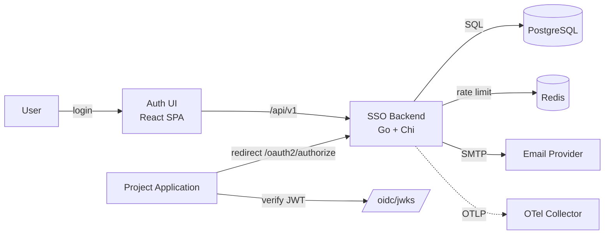
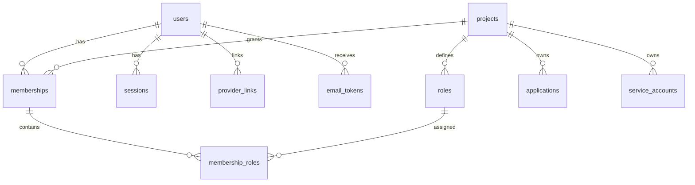
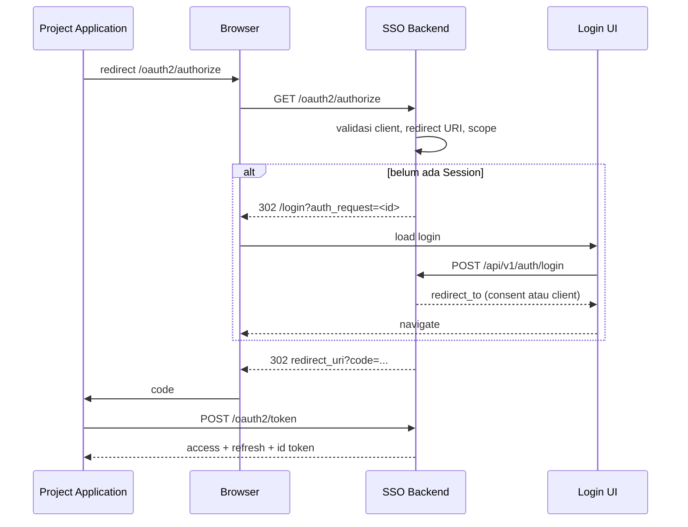
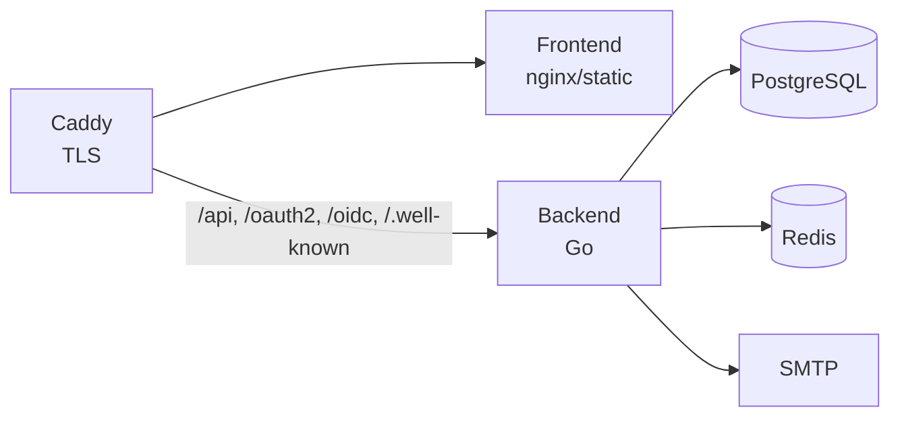

# SSO Service — Arsitektur

**Status:** Disepakati · 13 November 2026
**Repo:** `PRJ-0002_sso`
**Module Go:** `github.com/ppabimanyu/sso`
**Implementasi:** belum dimulai — dokumen ini adalah kontrak desain.

SSO service untuk project pribadi: satu identitas untuk semua aplikasi, baik user internal maupun publik. Dibangun di atas fondasi `PRJ-0001_boilerplate` (Go + React), dengan Zitadel sebagai referensi fitur.

## 1. Ruang lingkup

### Disertakan

- OIDC/OAuth 2.0 provider: Authorization Code + PKCE, Client Credentials, refresh token rotation, discovery, JWKS, introspection, revocation, userinfo.
- Hosted login, consent untuk Application non-trusted, dan SSO antar Project.
- Siklus akun: registrasi, verifikasi email, login, magic link, reset password, ganti email, nonaktif, hapus akun.
- MFA: TOTP, passkey/WebAuthn, recovery code.
- Social login: Google dan GitHub, dengan account linking yang dibatasi.
- Session: cookie SSO, daftar dan revoke session, RP-initiated logout.
- Registry Project, Application, Role, Membership, dan Service Account.
- Account console dan admin console.
- Audit Event append-only.
- Email outbox + SMTP.
- Machine-to-machine lewat Client Credentials.

### Tidak disertakan

- SAML, LDAP, SCIM, template Entra/Okta.
- Organization, tenant, granted project, delegated administration, custom domain per Project.
- Actions JavaScript, token exchange, impersonation, custom login API.
- Device authorization, DPoP, PAR, JARM, mTLS, back-channel logout.
- SMS, i18n, quota, per-Project branding/policy.
- Event sourcing/CQRS, CockroachDB, gRPC, HA multi-region.
- Billing, team management, user import.

## 2. Prinsip desain

- **Kontrak standar** — Application hanya melihat OIDC/OAuth standar. Zitadel atau Keycloak harus bisa menggantikan service ini tanpa mengubah Application.
- **Satu deployable service** — satu binary Go, PostgreSQL, dan Redis. Tidak ada message broker atau job queue eksternal.
- **Single tenant** — satu Instance, satu user pool global, akses per Project lewat Membership.
- **Least privilege di token** — token untuk satu Application tidak membawa Role dari Project lain.
- **Boring dan bisa diaudit** — library yang dipakai Zitadel, hashing standar, token rotation, redirect URI exact match.
- **Explicit no** — fitur yang dibuang dicatat di ADR dan dokumen ini, supaya tidak ditambahkan tanpa keputusan.

## 3. Tech stack

| Bagian | Teknologi |
| --- | --- |
| Backend | Go 1.27, chi, pgx, sqlc, goose |
| OIDC | `github.com/zitadel/oidc/v3` |
| Database | PostgreSQL |
| Cache/rate limit | Redis |
| WebAuthn | `github.com/go-webauthn/webauthn` |
| TOTP | `github.com/pquerna/otp` |
| Password | Argon2id (`golang.org/x/crypto`) |
| Observability | OpenTelemetry, OTLP, slog |
| Frontend | React 19, Vite, TypeScript |
| UI | Tailwind CSS v4, shadcn/ui, lucide-react |
| Routing/data | React Router v7, TanStack Query v5, openapi-fetch |
| Testing | testify, testcontainers, Vitest, React Testing Library, MSW |
| Deployment | Docker Compose, Caddy, Mailpit (dev) |

## 4. Arsitektur sistem

- Auth UI dan API dilayani dari satu origin `https://auth.<domain>`.
- Project Application tetap di domainnya sendiri; SSO terjadi lewat redirect OIDC.
- Resource server memverifikasi Access Token secara offline lewat JWKS.
- Redis hanya untuk rate limit dan cache; sumber kebenaran tetap PostgreSQL.

## 5. Model domain

| Konsep | Arti |
| --- | --- |
| **Instance** | Satu deployment SSO service dengan satu user pool. |
| **User** | Identitas global satu orang, dikenali lewat email. |
| **Project** | Produk/aplikasi pribadi; container untuk Application dan Role. |
| **Application** | OIDC client user-facing milik satu Project. |
| **Service Account** | Identitas machine dengan client credentials dan Role sendiri. |
| **Membership** | Hubungan User–Project yang memberi satu atau lebih Role. |
| **Role** | String bermakna milik satu Project, muncul di token. |
| **Admin** | User dengan flag global `is_admin`; wajib MFA. |
| **Trusted Application** | Application yang dilewati Consent. |

Aturan:

- Satu User boleh menjadi anggota banyak Project.
- Satu Application hanya milik satu Project.
- Role hanya berlaku di Project tempat ia didefinisikan.
- Token untuk Application berisi Role dari Project Application itu saja.
- `is_admin` adalah satu-satunya role global.

### 5.1 Kebijakan akses Application

`access_mode` menentukan siapa yang boleh memakai Application:

| Mode | Registrasi | Akses |
| --- | --- | --- |
| `open` | Terbuka | Semua User terautentikasi; Role boleh kosong. |
| `invite` | Hanya undangan | User yang diundang dan punya Membership. |
| `membership` | Tertutup | Hanya User dengan Membership. |

Registrasi publik membuat User global; Membership tidak dibuat otomatis. Application dengan mode `open` menerima User tanpa Membership; Role diberikan lewat admin console atau undangan.

## 6. Alur autentikasi

### 6.1 Authorization Code + PKCE

Langkah:

1. Validasi `client_id`, `redirect_uri` exact match, `response_type=code`, scope, PKCE.
2. Cek Session cookie. Jika ada dan Application trusted, terbitkan code langsung.
3. Jika belum ada, redirect ke `/login?auth_request=<id>`.
4. Login UI mengambil konteks lewat `GET /api/v1/auth/request/{id}`.
5. Setelah autentikasi berhasil, Session dibuat dan Auth Request dilanjutkan.
6. Consent ditampilkan hanya untuk Application non-trusted.
7. Authorization code diterbitkan (sekali pakai, 60 detik), lalu redirect.
8. Token endpoint menukar code + PKCE verifier menjadi token.

### 6.2 Magic link

- User memasukkan email di halaman login.
- Response selalu sama, baik email terdaftar maupun tidak (anti-enumeration).
- Email Token berlaku 10 menit, sekali pakai, dan terikat ke Auth Request.
- Membuka link membuat Session lalu melanjutkan Auth Request.
- Magic link hanya untuk login User yang sudah ada; signup tetap lewat form.

### 6.3 Social login

- Provider v1: Google dan GitHub.
- Alur memakai `state` + PKCE; callback divalidasi terhadap state cookie.
- Auto-link hanya jika provider menyatakan email terverifikasi dan email lokal sudah terverifikasi.
- Selain itu, User harus login lalu melakukan link eksplisit dari account console.
- Social signup membuat User baru dengan status email sesuai klaim provider.
- Unlink hanya boleh jika User masih punya metode login lain.

### 6.4 MFA

- TOTP wajib untuk Admin; opsional untuk User publik.
- Passkey/WebAuthn bisa menjadi faktor pertama sekaligus faktor kedua.
- Recovery code: 10 kode sekali pakai, di-hash.
- Setelah faktor pertama berhasil, jika MFA diperlukan, backend menerbitkan MFA ticket berumur 5 menit dan sekali pakai.
- MFA ticket disimpan sebagai hash di Auth Request; cookie `__Host-sso_mfa` bersifat HttpOnly.
- TOTP memakai jendela ±1 langkah 30 detik dan menolak replay berdasarkan `last_used_at`.

### 6.5 Refresh dan logout

- Refresh token opaque, 30 hari, dirotasi setiap dipakai.
- Reuse token lama mencabut seluruh family dan semua Session turunannya.
- Logout memakai RP-initiated logout: Session dihapus, lalu redirect ke `post_logout_redirect_uri` yang terdaftar.
- Tidak ada back-channel logout di v1; Application lain kehilangan akses saat Access Token kedaluwarsa.

### 6.6 Client Credentials

- Service Account adalah OAuth client dengan tipe machine.
- Token tidak memakai refresh token.
- `sub` = Service Account ID, `aud` = audience yang dikonfigurasi, `roles` = Role Service Account.
- Client secret di-hash; secret hanya ditampilkan sekali saat dibuat atau dirotasi.

## 7. Token dan Session

### Access Token

- JWT RS256, umur 15 menit.
- Diverifikasi offline lewat JWKS; `kid` menunjuk key aktif.
- Claim: `iss`, `sub`, `aud`, `exp`, `iat`, `jti`, `scope`, `roles`, `sid`, `amr`, dan claim profil sesuai scope.
- `aud` = `client_id` Application.
- `roles` hanya berisi Role dari Project Application tersebut.
- `sid` = Session ID, untuk korelasi logout.

### Refresh Token

- Opaque 256-bit, di-hash SHA-256 di database.
- Umur 30 hari; dirotasi setiap dipakai.
- Family disimpan untuk mendeteksi reuse.
- Reuse mencabut family dan Session terkait.

### ID Token

- Standar OIDC, ditandatangani dengan key yang sama.
- Berisi `nonce` dari Auth Request.
- Claim profil mengikuti scope `profile` dan `email`.

### Session

- Opaque 256-bit, di-hash di database.
- Cookie `__Host-sso_session`: HttpOnly, Secure, SameSite=Lax, Path=/.
- Idle 30 hari, absolut 90 hari.
- Session ID dirotasi saat login dan privilege change.
- Daftar Session bisa dilihat dan dicabut dari account console.
- Ganti password dan reset password mencabut semua Session lain.

### Key management

- Signing key berupa PEM di file/secret mount.
- `kid` aktif dan `kid` sebelumnya disajikan di JWKS.
- Rotasi manual: generate key baru, deploy sebagai aktif, pertahankan key lama sampai Access Token tertua kedaluwarsa, lalu retire.
- Private key tidak pernah masuk database atau log.

## 8. Otorisasi

- Role adalah string; tidak ada model permission.
- Application menafsirkan arti Role.
- Scope OIDC (`openid`, `profile`, `email`) tidak dipakai untuk otorisasi Role.
- Admin API dijaga `is_admin` dan MFA; admin console memakai Session same-origin, bukan Access Token.
- Jika admin console suatu saat dipisah ke origin lain, ia menjadi Application dengan audience `sso-admin`.

## 9. Skema data

Semua primary key UUIDv7 yang dibuat aplikasi. Semua timestamp `timestamptz` UTC. Email memakai `citext`.

| Tabel | Isi | Kolom kunci |
| --- | --- | --- |
| `users` | Identitas global | `id`, `email` (unique), `email_verified_at`, `name`, `picture_url`, `is_admin`, `disabled_at`, `deleted_at` |
| `password_credentials` | Hash password | `user_id` (pk), `password_hash`, `updated_at` |
| `totp_credentials` | TOTP | `user_id` (pk), `secret_encrypted`, `confirmed_at`, `last_used_at` |
| `webauthn_credentials` | Passkey | `id`, `user_id`, `credential_id` (unique), `public_key`, `sign_count`, `transports`, `name`, `last_used_at` |
| `recovery_codes` | Kode pemulihan | `id`, `user_id`, `code_hash`, `used_at` |
| `provider_links` | Link social | `id`, `user_id`, `provider`, `subject`, `email_at_link`, unique(provider, subject) |
| `projects` | Produk | `id`, `name`, `slug` (unique) |
| `roles` | Role per Project | `project_id`, `key`, `name`, `description`, pk(project_id, key) |
| `applications` | OIDC client user-facing | `id`, `project_id`, `name`, `client_id` (unique), `client_secret_hash`, `type`, `redirect_uris`, `post_logout_redirect_uris`, `allowed_scopes`, `trusted`, `access_mode`, `access_token_ttl_seconds`, `refresh_token_ttl_seconds`, `disabled_at` |
| `service_accounts` | Identitas machine | `id`, `project_id`, `name`, `client_id` (unique), `client_secret_hash`, `audience`, `disabled_at` |
| `service_account_roles` | Role machine | `service_account_id`, `role_key` |
| `memberships` | User ↔ Project | `id`, `user_id`, `project_id`, unique(user_id, project_id) |
| `membership_roles` | Role membership | `membership_id`, `role_key` |
| `consents` | Consent yang diingat | `user_id`, `application_id`, `scopes`, `created_at`, `revoked_at`, pk(user_id, application_id) |
| `sessions` | Session SSO | `id`, `token_hash` (unique), `user_id`, `auth_method`, `mfa_at`, `ip`, `user_agent`, `created_at`, `last_seen_at`, `idle_expires_at`, `absolute_expires_at`, `revoked_at` |
| `auth_requests` | State OIDC | `id`, `client_id`, `redirect_uri`, `scope`, `state`, `nonce`, `code_challenge`, `code_challenge_method`, `prompt`, `max_age`, `login_hint`, `session_id`, `user_id`, `mfa_ticket_hash`, `mfa_expires_at`, `consent_at`, `completed_at`, `expires_at` |
| `auth_codes` | Authorization code | `code_hash` (pk), `auth_request_id`, `user_id`, `client_id`, `redirect_uri`, `scope`, `nonce`, `code_challenge`, `code_challenge_method`, `expires_at`, `used_at` |
| `email_tokens` | Token email | `id`, `user_id` (null), `email`, `purpose`, `token_hash` (unique), `new_email`, `auth_request_id`, `expires_at`, `used_at` |
| `webauthn_challenges` | Challenge WebAuthn | `id`, `user_id`, `kind`, `session_data` (jsonb), `expires_at` |
| `audit_events` | Audit | `id`, `occurred_at`, `actor_type`, `actor_user_id`, `action`, `target_type`, `target_id`, `ip`, `user_agent`, `request_id`, `metadata` (jsonb) |
| `outbox_emails` | Email queue | `id`, `to_email`, `template`, `payload` (jsonb), `status`, `attempts`, `next_attempt_at`, `last_error`, `created_at`, `sent_at` |

Indexes penting:

- `users.email` unique.
- `sessions.token_hash`, `sessions.user_id`.
- `auth_requests.expires_at`, `auth_codes.expires_at`.
- `email_tokens.token_hash`, `email_tokens.expires_at`.
- `audit_events.occurred_at`, `audit_events.actor_user_id`.
- `outbox_emails(status, next_attempt_at)`.

Retensi:

- `sessions` kedaluwarsa: purge setelah 30 hari.
- `auth_requests` dan `auth_codes`: purge setelah 1 hari.
- `email_tokens`: purge setelah 7 hari.
- `outbox_emails` terkirim: purge setelah 30 hari.
- `audit_events`: 1 tahun (configurable).
- User soft-deleted: purge PII setelah 30 hari; Audit Event tetap dengan `user_id`.

## 10. Permukaan API

### OIDC

| Method | Path | Fungsi |
| --- | --- | --- |
| GET | `/.well-known/openid-configuration` | Discovery |
| GET | `/oidc/jwks` | Public keys |
| GET | `/oauth2/authorize` | Authorization endpoint |
| POST | `/oauth2/token` | Token endpoint |
| GET | `/oauth2/userinfo` | Userinfo |
| POST | `/oauth2/introspect` | Introspection |
| POST | `/oauth2/revoke` | Revocation |
| GET | `/oauth2/end_session` | RP-initiated logout |

### Auth API

| Method | Path | Fungsi |
| --- | --- | --- |
| GET | `/api/v1/auth/request/{id}` | Konteks Auth Request untuk login UI |
| POST | `/api/v1/auth/login` | Email + password |
| POST | `/api/v1/auth/magic-link` | Minta magic link |
| POST | `/api/v1/auth/magic-link/consume` | Tukar token jadi Session |
| POST | `/api/v1/auth/passkey/begin` | Mulai WebAuthn |
| POST | `/api/v1/auth/passkey/finish` | Selesaikan WebAuthn |
| POST | `/api/v1/auth/totp/verify` | Verifikasi TOTP |
| POST | `/api/v1/auth/recovery/verify` | Verifikasi recovery code |
| GET | `/api/v1/auth/social/{provider}/start` | Mulai social login |
| GET | `/api/v1/auth/social/{provider}/callback` | Callback provider |
| POST | `/api/v1/auth/consent` | Allow/deny Consent |
| GET | `/api/v1/auth/session` | Session aktif |
| POST | `/api/v1/auth/logout` | Logout |

### Account API

| Method | Path | Fungsi |
| --- | --- | --- |
| GET/PATCH | `/api/v1/me` | Profil |
| POST | `/api/v1/me/email` | Minta ganti email |
| POST | `/api/v1/me/password` | Ganti password |
| GET | `/api/v1/me/mfa` | Status MFA |
| POST/DELETE | `/api/v1/me/mfa/totp` | Enroll/hapus TOTP |
| POST/DELETE | `/api/v1/me/mfa/webauthn` | Daftar/hapus passkey |
| POST | `/api/v1/me/mfa/recovery-codes` | Generate recovery code |
| GET/DELETE | `/api/v1/me/sessions/{id}` | Lihat/cabut Session |
| GET/DELETE | `/api/v1/me/connections/{id}` | Lihat/unlink social |
| GET | `/api/v1/me/memberships` | Project dan Role |
| DELETE | `/api/v1/me` | Hapus akun (soft delete) |

### Admin API

| Method | Path | Fungsi |
| --- | --- | --- |
| GET/POST | `/api/v1/admin/projects` | List/create Project |
| GET/PATCH/DELETE | `/api/v1/admin/projects/{id}` | Detail/ubah/hapus Project |
| GET/POST | `/api/v1/admin/projects/{id}/applications` | List/create Application |
| GET/PATCH/DELETE | `/api/v1/admin/applications/{id}` | Detail/ubah/hapus Application |
| POST | `/api/v1/admin/applications/{id}/rotate-secret` | Rotasi client secret |
| GET/POST | `/api/v1/admin/projects/{id}/roles` | List/create Role |
| GET/PATCH/DELETE | `/api/v1/admin/roles/{id}` | Detail/ubah/hapus Role |
| GET | `/api/v1/admin/users` | List/cari User |
| GET/PATCH | `/api/v1/admin/users/{id}` | Detail/ubah User |
| POST | `/api/v1/admin/users/{id}/disable` | Nonaktifkan |
| POST | `/api/v1/admin/users/{id}/enable` | Aktifkan |
| POST | `/api/v1/admin/users/{id}/memberships` | Tambah Membership/Role |
| DELETE | `/api/v1/admin/users/{id}/memberships/{id}` | Hapus Membership |
| POST | `/api/v1/admin/users/{id}/reset-password` | Kirim reset |
| GET/POST | `/api/v1/admin/service-accounts` | List/create Service Account |
| POST | `/api/v1/admin/service-accounts/{id}/rotate-secret` | Rotasi secret |
| GET | `/api/v1/admin/audit-events` | Audit |
| GET/DELETE | `/api/v1/admin/sessions/{id}` | Lihat/cabut Session |

Konvensi mengikuti boilerplate: JSON `camelCase`, error RFC 7807, pagination `limit/offset`, OpenAPI digenerate dari anotasi Go.

## 11. Frontend

Satu React app, tiga permukaan:

| Area | Route | Isi |
| --- | --- | --- |
| Login | `/login`, `/register`, `/verify-email`, `/reset-password`, `/magic-link`, `/consent` | Autentikasi dan consent |
| Account | `/account/profile`, `/account/security`, `/account/sessions`, `/account/connections` | Self-service User |
| Admin | `/admin/projects`, `/admin/projects/:id`, `/admin/users`, `/admin/audit` | Pengelolaan Instance |

- Feature-based: `features/auth`, `features/account`, `features/admin`, `features/consent`.
- Bahasa UI dan template email: English. Dokumentasi internal: Indonesian.
- API client dari OpenAPI; TanStack Query untuk server state.
- Tidak ada SSR dan tidak ada token di `localStorage`; console memakai Session cookie.
- Login page memakai alur email-first: masukkan email, lalu tampilkan metode yang tersedia (passkey, password, magic link, social).
- Error problem+json dipetakan ke pesan UI; tidak membocorkan apakah email terdaftar.

## 12. Keamanan

### Password

- Argon2id: memory 64 MiB, iterations 3, parallelism 2, salt 16 byte, hash 32 byte.
- Panjang 12–128 karakter; tanpa aturan komposisi; tolak password yang sama dengan email.
- Reset password mencabut semua Session.
- Password breach check (HIBP) ditunda ke P2.

### Token dan redirect

- PKCE wajib untuk public client; hanya `S256`.
- `redirect_uri` exact match; HTTPS kecuali `localhost`; tanpa wildcard.
- `state` dan `nonce` divalidasi.
- Authorization code 60 detik, sekali pakai.
- Refresh token rotation + reuse detection.
- Tidak ada token di query string selain authorization code.

### Session dan CSRF

- Cookie `__Host-`, HttpOnly, Secure, SameSite=Lax.
- State-changing request memvalidasi `Origin`/`Sec-Fetch-Site`.
- Login CSRF dicegah dengan state Auth Request dan cookie MFA yang HttpOnly.
- Session dirotasi saat login dan privilege change.

### Rate limit dan lockout

- Redis sebagai primary; in-process limiter sebagai fallback saat Redis down.
- Login: 10 kegagalan/15 menit per akun + IP; ditahan 15 menit, bukan lock permanen.
- Magic link dan reset: 5 request/15 menit per email + IP.
- Token endpoint: 60 request/menit per client.
- Counter reset setelah login sukses.

### Secret

- Client secret dan recovery code di-hash SHA-256.
- TOTP secret dienkripsi AES-GCM dengan `APP_ENCRYPTION_KEY`.
- Session, refresh, authorization code, dan email token disimpan sebagai hash.
- Signing key di file/secret mount; tidak pernah masuk database atau log.

### Header dan browser

- HSTS, CSP `default-src 'self'; frame-ancestors 'none'`, `X-Content-Type-Options: nosniff`, `Referrer-Policy: strict-origin-when-cross-origin`.
- `Permissions-Policy` menonaktifkan kamera, mikrofon, dan geolokasi.
- Tidak ada third-party script di halaman login dan consent.

### Audit Event

Dicatat minimal: login sukses/gagal, logout, registrasi, verifikasi email, reset password, ganti email, enroll/hapus MFA, pembuatan/rotasi client secret, perubahan Role/Membership, disable/enable User, dan akses admin ke data sensitif.

### PII

- Data minimal: email, nama, avatar URL, IP, user agent.
- Tidak ada nomor telepon di v1.
- Soft delete 30 hari, lalu purge PII; Audit Event tetap dengan `user_id` pseudonymous.
- Log tidak memuat token, password, TOTP secret, atau isi email.

## 13. Email

- Outbox pattern: transaksi menulis `outbox_emails`, worker in-process mengirim dengan retry exponential (1m, 5m, 30m, 2h, 6h; maksimum 10 attempt).
- SMTP generik; Mailpit di development.
- Template: verifikasi email, reset password, magic link, ganti email, undangan, notifikasi password berubah.
- TTL: verifikasi 24 jam, reset 30 menit, magic link 10 menit, undangan 7 hari.
- Email Token sekali pakai dan di-hash.
- Pengiriman tidak boleh menahan request HTTP; worker berjalan di binary yang sama.

## 14. Observability

Mengikuti boilerplate:

- OTel trace dan metrics via OTLP; `otelhttp`, `otelpgx`, runtime Go.
- Log JSON `slog` dengan `trace_id`, `span_id`, `request_id`.
- Response header `X-Trace-Id` dan `X-Request-Id`.
- Metrics tambahan: login success/failure, token issuance, active sessions, MFA enrollment, email outbox lag.
- Audit Event terpisah dari log aplikasi.

## 15. Deployment dan konfigurasi

### Topology

- Satu origin: Caddy menyajikan frontend dan mem-proxy path backend.
- Docker Compose: `db`, `redis`, `migrate`, `backend`, `frontend`, `caddy`; profil `dev` menambah Mailpit; profil `observability` menambah OTel Collector/Jaeger/Prometheus.
- Migrasi goose dijalankan sebelum backend baru menerima traffic.
- Backup PostgreSQL harian, retensi 14 hari. Redis tidak perlu durable.
- Single instance; tidak ada HA di v1.

### Environment

| Variabel | Default | Fungsi |
| --- | --- | --- |
| `APP_ENV` | `development` | Environment |
| `PORT` | `8080` | Port backend |
| `PUBLIC_ORIGIN` | wajib | `https://auth.<domain>` |
| `DATABASE_URL` | wajib | PostgreSQL |
| `REDIS_URL` | wajib | Redis |
| `SIGNING_KEY_FILE` | wajib | PEM private key aktif |
| `SIGNING_KEY_ID` | wajib | `kid` aktif |
| `SIGNING_KEY_PREVIOUS_FILE` | kosong | PEM key sebelumnya |
| `SIGNING_KEY_PREVIOUS_ID` | kosong | `kid` sebelumnya |
| `APP_ENCRYPTION_KEY` | wajib | 32 byte base64 untuk AES-GCM |
| `SESSION_IDLE_TTL` | `720h` | Idle Session |
| `SESSION_ABSOLUTE_TTL` | `2160h` | Absolute Session |
| `LOGIN_MAX_FAILURES` | `10` | Kegagalan login sebelum lockout |
| `LOGIN_FAILURE_WINDOW` | `15m` | Window kegagalan dan durasi lockout |
| `ACCESS_TOKEN_TTL` | `15m` | Access Token |
| `REFRESH_TOKEN_TTL` | `720h` | Refresh Token |
| `SMTP_URL` | wajib | Koneksi SMTP |
| `EMAIL_FROM` | wajib | Alamat pengirim |
| `GOOGLE_CLIENT_ID` | kosong | Social login |
| `GOOGLE_CLIENT_SECRET` | kosong | Social login |
| `GITHUB_CLIENT_ID` | kosong | Social login |
| `GITHUB_CLIENT_SECRET` | kosong | Social login |
| `BOOTSTRAP_ADMIN_EMAIL` | kosong | Admin pertama saat seed |
| `BOOTSTRAP_ADMIN_PASSWORD` | kosong | Password Admin pertama; hanya dipakai saat pembuatan |
| `RATE_LIMIT_REQUESTS` | `60` | Limit umum |
| `RATE_LIMIT_WINDOW` | `1m` | Window umum |
| `OTEL_*` | kosong | Observability |

## 16. Testing

- **Unit**: logic auth, token claim, password, TOTP, validasi redirect URI.
- **Integration**: repository dan full OIDC flow dengan PostgreSQL/Redis via testcontainers.
- **Frontend**: Vitest + RTL + MSW.
- **Conformance**: OpenID conformance suite (basic OP profile) dijalankan sebelum v1 dianggap selesai; bukan gate setiap PR.
- **CI**: lint, unit test, integration test, generate-check, build, Trivy.
- Playwright tidak menjadi gate; dapat ditambahkan setelah v1 untuk regresi UI.

## 17. Milestone

| Milestone | Isi | Exit criteria |
| --- | --- | --- |
| **M0** | Fork boilerplate, rename module, CI, compose + Mailpit | `make dev` jalan, CI hijau |
| **M1** | OIDC core, password login, registry Project/Application, demo client | Satu app login end-to-end dan menerima token dengan Role |
| **M2** | Registrasi, verifikasi email, reset password, ganti email, account console, email outbox | User bisa self-register, verifikasi, reset, kelola profil |
| **M3** | TOTP, passkey, recovery code, session management, social login, magic link | Semua metode login v1 bekerja; Admin wajib MFA |
| **M4** | Admin console lengkap, audit viewer, hardening, conformance suite | Basic OP conformance lulus; checklist keamanan selesai |
| **M5** | Production: TLS, backup, monitoring, runbook | Domain auth live; Project pertama memakai SSO |

## 18. Non-goals

- Menjadi identity provider enterprise (SAML, LDAP, SCIM, delegated admin).
- Multi-tenant B2B dengan isolasi user per organisasi.
- Menjalankan JavaScript custom di dalam auth flow (Actions).
- Billing, subscription, atau team management.
- HA multi-region dan event sourcing.
- Menyimpan token di browser (`localStorage`/`sessionStorage`).

## 19. Keputusan terbuka

Tidak ada keputusan arsitektur yang terbuka. Yang tersisa hanya konfigurasi deployment: domain final, provider SMTP, dan host target.

## 20. Referensi

- [GLOSSARY.md](../GLOSSARY.md)
- [ADR 0001 — Build a scoped IdP on the Zitadel OIDC library](adr/0001-build-scoped-idp-on-zitadel-oidc.md)
- [ADR 0002 — Single-tenant identity model](adr/0002-single-tenant-project-scoped-roles.md)
- [ADR 0003 — OIDC and OAuth 2.0 only](adr/0003-oidc-only.md)
- [ADR 0004 — JWT access tokens with rotating refresh tokens](adr/0004-jwt-access-tokens-with-rotating-refresh-tokens.md)
- [ADR 0005 — Single auth origin with a host-only session cookie](adr/0005-single-auth-origin-host-only-cookie.md)
- [ADR 0006 — Audience-scoped role claims](adr/0006-audience-scoped-role-claims.md)
- [ADR 0007 — Auth domain module](adr/0007-auth-domain-module.md)
